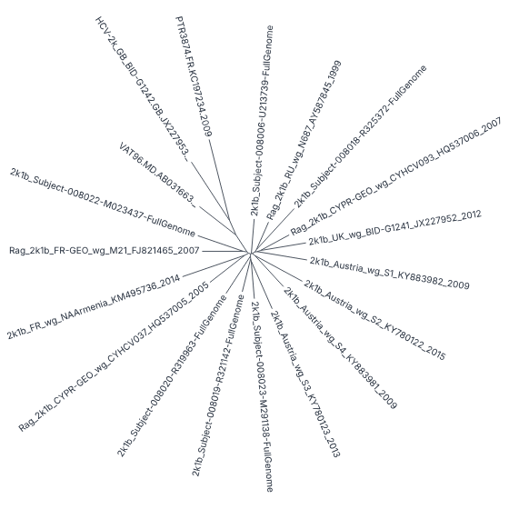
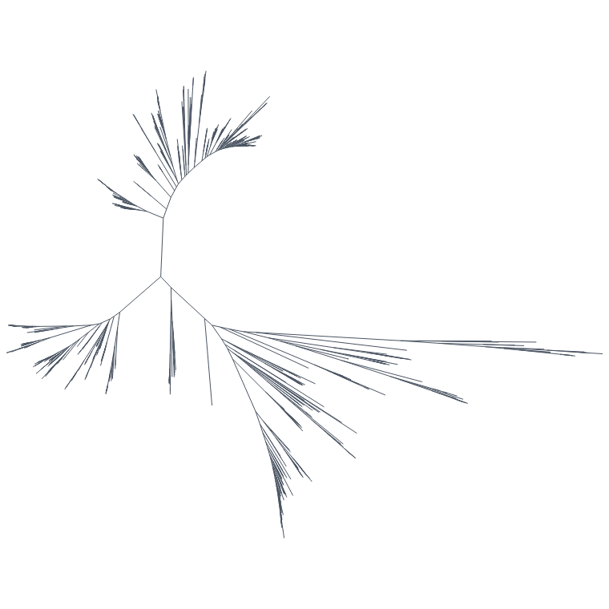
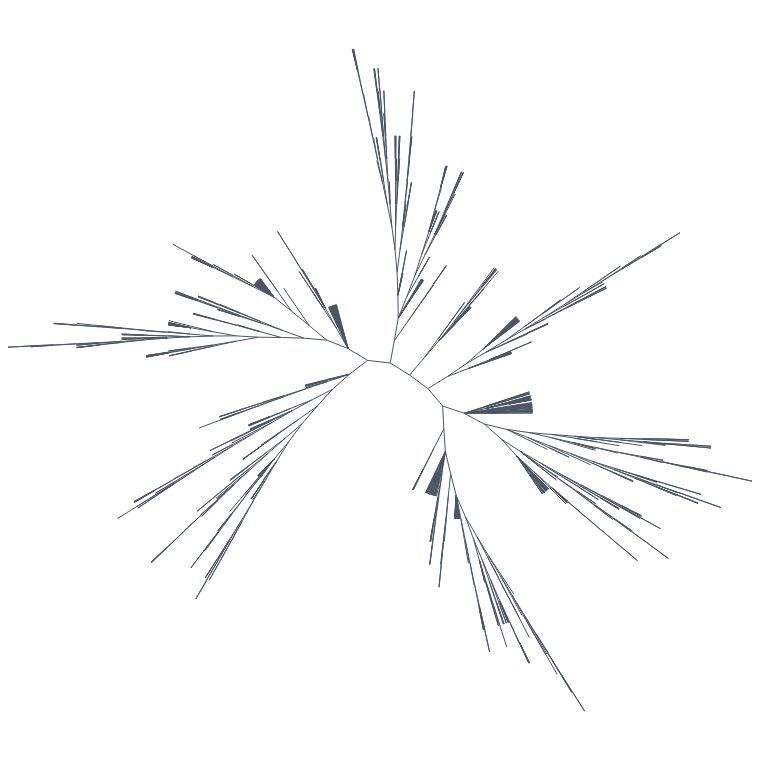
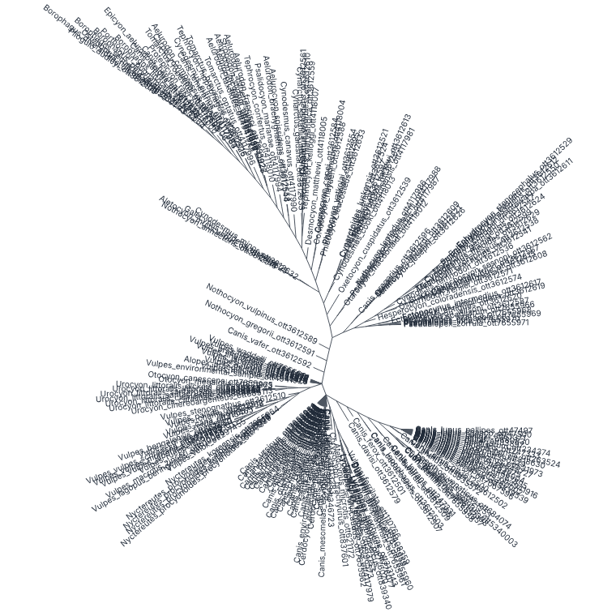

# Unrooted layout, equal-angle: the spike (#42)

Written 2026-10-23. The spike is an equal-angle layout pass, `unrootedLayout(tree)` in
[`packages/viewer/src/unrooted.ts`](../../packages/viewer/src/unrooted.ts), with unit tests in
[`packages/viewer/test/unrooted.test.mjs`](../../packages/viewer/test/unrooted.test.mjs). There is also a throw-away canvas page that
draws every branch with no level of detail: [`examples/unrooted`](../../examples/unrooted), on the demo site as `/unrooted`. It imports
the layout from the viewer's source and is not in a package. The viewer has no `layout: 'unrooted'` yet; this note is for deciding whether it should.

Marks: **(M)** measured here, with the command given. **(R)** from reading the code. **unverified**: from memory or estimated.

## The algorithm

Equal-angle. Every tip gets the same share of the circle, `unit = 2π / tips`. A node's wedge spans its tips times `unit`, and starts
where the wedges of its earlier siblings end. The root's wedge is the whole circle. The branch to a node points along the middle of the
node's wedge and is drawn at its length. It is one preorder pass over the tree arrays, with no recursion and no per-node objects. The
output is three `Float64Array`s: X, Y and the wedge start, 24 bytes per node (65 MB at the 2.73M nodes of the full OTL tree). The wedge
span is not stored because it follows from the tip range. **(R)**

The method is usually credited to Felsenstein's PHYLIP program `drawtree`, and equal-daylight (below) to Felsenstein too, as used in
SplitsTree and other programs. Both attributions are from memory, **unverified**.

Properties, shown in the unit tests **(M)**:

- **Branches at their lengths, along the middle of the node's wedge.** On random trees (binary, polytomies, ladders) every edge's
  length equals the tree's branch length to 1e-9, and its direction is the middle of the node's wedge.
- **Wedges nested and disjoint.** The children's wedges tile the parent's wedge in order, and the root's wedge is the whole circle.
- **No crossing branches.** An O(n²) segment-intersection check finds no crossings on 75 random trees of 5 to 65 tips. The ladder
  trees are included, and the test asserts that some of their wedges are wider than π (non-convex cones).
- **The same picture from another root.** The same unrooted tree, written with two different roots that keep the cyclic order of
  neighbours, gives the same tip-to-tip distances.
- **A small tree checked by hand**: `((A:1,B:2)AB:1,C:1,D:3)root;`.

**Why starting from the root is fine.** At any node, the angle between two neighbouring edges is half the sum of the two components'
tip counts, times `unit`. The two edges can be two children, or the last child and the edge back towards the root. That depends only
on the unrooted tree and the cyclic order of the neighbours, so the drawing is the same, up to a rotation, whichever node it starts
from. A degree-2 root therefore lies on a straight line: its two edges are π apart. The other property follows from a centroid. Started
from a centroid, every wedge is at most π and so a convex cone. A subtree then stays inside its parent's cone, and siblings cannot
overlap. **(R)**: the argument is mine, not checked against the literature. The random-tree check above supports it.

**Without branch lengths.** A tree without lengths, or `branchLengths` false, draws every branch at length 1. The OTL trees have no
lengths. If every length in the tree is 0, the unit lengths are used too. In a tree that has lengths, a missing or negative length
counts as 0, as in `computeLayout`, so that node sits on its parent. With unit lengths the drawing still separates the clades, but its
distances mean nothing. Deep, thin clades become long spikes (Testudines, below).

## Pictures

Made with `tests/browser/bench/unrooted-shots.mjs` (usage in its header) against the dev server, headless Chromium 141.0.7390.37,
2026-10-23 **(M)**. The PNGs are reduced to 32 colours. Tip labels are drawn along each tip's direction, and only up to 250 tips. The
trees are in `data/` (licences and provenance in `data/real-ladder/README.md` and `data/rich/hcv-2k-iqtree-alignment/NOTES.md`; GTDB
is CC BY-SA 4.0).

**HCV 2k, IQ-TREE (19 tips, branch lengths).** The case the layout is for: a maximum-likelihood tree, whose midpoint root is an
artefact. At this size every label is readable.



**GTDB Nitrososphaeria (932 tips, 1,863 nodes, branch lengths).** The well-separated groups and the long branches stand out, as the
issue expected. There is a large empty sector, the known weakness of equal-angle: a clade gets angle by its tip count, not by how much
room it needs.



**OTL Testudines (888 tips, 1,465 nodes, no lengths, so unit lengths).** It is readable as a topology. Deep clades become long spikes,
and big polytomies become solid fans. Without lengths an unrooted drawing says little more than a radial one.



**OTL Canidae (211 tips, 367 nodes, unit lengths, labels).** Labels pointing every way overlap badly well below 2,000 nodes, where
polytomies and short branches put many tips close together. Even a small-tree-only layout needs a label rule: skip the labels that
collide, or show labels only when zoomed.



## Timings

**The layout pass in Node (M).** Machine: cloud sandbox, 4 vCPU Intel Xeon @ 2.80 GHz, 15 GB, Node v22.22.0, 2026-10-23. For each
tree the script parses once, then runs `unrootedLayout` and `computeLayout(tree, true)` (the rectangular and radial pass, for scale)
15 times alternately, with a gc before each run. Command:

```
node --experimental-transform-types --no-warnings --expose-gc --max-old-space-size=8000 tests/browser/bench/unrooted-layout.mjs \
  data/real-ladder/trees/gtdb-190k-bacteria.nwk.gz data/real-ladder/fetched/otl-2m-full.nwk.gz ...
```

| tree | tips | nodes | lengths | unrootedLayout min / median | computeLayout min / median |
|---|---:|---:|---|---:|---:|
| otl-0200-canidae | 211 | 367 | unit | 0.1 / 0.2 ms | 0.1 / 0.2 ms |
| otl-1k-testudines | 888 | 1,465 | unit | 0.1 / 0.2 ms | 0.3 / 0.6 ms |
| gtdb-1k-nitrososphaeria | 932 | 1,863 | yes | 0.1 / 0.6 ms | 0.5 / 0.8 ms |
| otl-10k-amphibia | 10,018 | 14,874 | unit | 1.0 / 1.1 ms | 0.3 / 0.4 ms |
| gtdb-100k-bacteria-random | 100,000 | 199,999 | yes | 13.9 / 14.9 ms | 5.1 / 5.4 ms |
| **gtdb-190k-bacteria** | 189,801 | 379,601 | yes | **28.0 / 29.5 ms** | 9.8 / 10.9 ms |
| **otl-2m-full** | 2,385,875 | 2,725,682 | unit | **179.8 / 201.9 ms** | 53.4 / 72.6 ms |

The largest tree is the full OTL synthesis tree, opentree16.1, at the path the examples' catalogue gives it,
`data/real-ladder/fetched/otl-2m-full.nwk.gz` (git-ignored). `data/real-ladder/fetch.sh otl` could not download its source here,
because `files.opentreeoflife.org` answered 403 through the sandbox's proxy. The file was taken instead from this repository's
`data/otl-large` branch (`git show origin/data/otl-large:trees/otl-2m-full.nwk.gz`, the file the catalogue names as `remote`). Its
uncompressed sha256 is `86bcd162bf307763225f0ba8e473c89b541231994269746e080a23fae66a9305` (M). The manifest has no entry for that rung
to check it against, so the 2,385,875 tips are the only cross-check, and they match custom.md.

The table is the first run. A repeat on the same day gave medians of 37.6 ms (190k) and 211.3 ms (2.4M) for `unrootedLayout`, and
26.0 and 91.4 ms for `computeLayout`, with the minimums within 10% of the table. Medians move by up to 30% between runs on this shared
machine.

So the pass is linear: about 75 ns per node. It costs two to three times `computeLayout`. The `cos` and `sin` per node are a large
part of that but not all of it. A scratch copy of the pass with the two calls replaced by a multiplication (not committed; same tree,
15 alternating runs, medians) took 21 to 25 ms instead of 38 to 44 ms at 190k, and 116 to 292 ms instead of 234 to 418 ms at 2.4M, over
two runs **(M, noisy)**. So the trig is roughly 30 to 50% of the pass. The rest is not profiled. At 190k the pass is one 30 to 40 ms
task; at 2.4M it is about 0.2 s, which a worker would need. Compare the parse at 2.4M: 2.2 to 2.8 s.

**Drawing in headless Chromium (M, relative only).** Chromium 141.0.7390.37 headless, **no GPU** (SwiftShader, CPU canvas through
`willReadFrequently`), same machine and date. The throw-away page draws every branch as one path, with no level of detail and no
labels above 250 tips. A redraw is what `paint()` in the page does: clear the canvas, stroke every branch as one path, and draw the
labels when they are on. It does not include sizing the canvas or fitting the drawing (measuring the labels and searching for the
scale), which the page does once per tree. Each figure is the median of 20 redraws of a 760 px canvas. The pixels are flushed by a
1-pixel `getImageData` inside the timing, so the raster is included as far as that flush forces it. Two runs of
`node bench/unrooted-shots.mjs`, 2026-10-23.
These figures compare sizes with each other; a real browser with a GPU will differ (**unverified** by how much).

| tree | nodes | redraw median, run 1 / run 2 |
|---|---:|---:|
| hcv-19 (labels) | 36 | 0.5 / 0.3 ms |
| otl-0200-canidae (211 labels) | 367 | 2.7 / 2.1 ms |
| otl-1k-testudines | 1,465 | 0.6 / 1.0 ms |
| gtdb-1k-nitrososphaeria | 1,863 | 0.9 / 1.2 ms |
| otl-10k-amphibia | 14,874 | 5.5 / 4.2 ms |
| gtdb-10k-archaea | 20,243 | 5.0 / 5.4 ms |
| gtdb-100k-bacteria-random | 199,999 | 56 / 52 ms |

Drawing about 2,000 nodes costs about 1 ms here. Labels cost more than branches: about 2 to 3 ms for 211 rotated labels.

**Equal-daylight, not built.** Each round rotates the subtrees around every internal node to even out the empty angles. A round is
O(n) or more, and rounds repeat until the change is small, with no fixed bound. At 2,000 nodes that would be milliseconds per round,
with 5 to 50 rounds typical (**unverified**, from memory).

## Recommendation: go, for small trees only, without level of detail

The drawing is cheap well past any tree we would offer it for. The layout pass is linear and well under a millisecond at 2,000 nodes.
The pictures show what the issue promised: separated groups and long branches, and no root to mislead. Morten's idea (issue comment,
2026-10-23) fits the measurements. The unrooted layout is offered only below a node limit and draws every node. Above the limit the
viewer does not offer it, and a rooted layout is assumed. That removes the expensive part of the original plan:

- **No third cut loop, no wedge-area collapse rule.** Below the limit there is nothing to collapse. Drawing everything, on a CPU canvas
  with no GPU, costs about 1 ms at 2,000 nodes and under 10 ms at 15,000 to 20,000 nodes (above).
- **The overview is the same drawing, small.** At 2,000 nodes the overview can redraw it whole each time, with no summary.
- **Hit-testing can be a linear scan** of up to 2,000 segments per pointer move, or a coarse grid built once. A scan at that size costs
  microseconds **(unverified)**.

The proposed limit is 2,000 nodes by default, as an option. The drawing would allow 10,000 to 20,000 nodes. The limit is set by
readability, not cost: at 2,000 nodes (about 1,000 tips) the tips are about 0.4° apart, and labels are already unreadable at 211 tips with polytomies
(Canidae above).

**What the full layout still needs:**

- `layout: 'unrooted'` in the viewer, with a fit to the bounding box, pan and zoom.
- A draw path that skips the cut. It needs a decision on how it joins the frame pipeline of `docs/internals.md`: a draw list without
  the cut, or a separate small renderer.
- Rotated tip labels with a collision rule.
- Hover, click and selection via the hit scan, and keyboard order by tip rank.
- Theme tokens for everything drawn.
- Turning off what does not apply: columns, alignments, aligned labels, the time axis, and collapsed clades (or drawn as a wedge).
- What happens when the tree grows past the limit, for example after expanding: fall back to radial and say so.
- Tests in the style of the radial ones: unit tests of the projection, and a browser check.

**Rough size (unverified):** 3 to 5 days without level of detail, against the issue's 1 to 2 weeks with it. Equal-daylight can come
later as an option below the same limit. At this size its cost matters little; the work is in tuning how many rounds to run.

**Open questions for Morten:**

- Is the limit by nodes (as suggested) or by tips?
- Should equal-daylight come in the first version or later?
- Is the drawing offered for trees without branch lengths, where it says little (Testudines above), or only when the tree has lengths?
