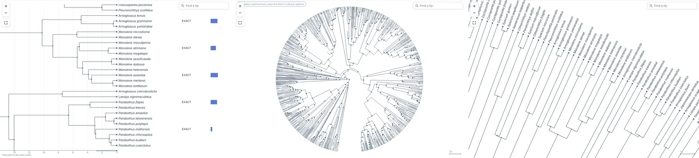
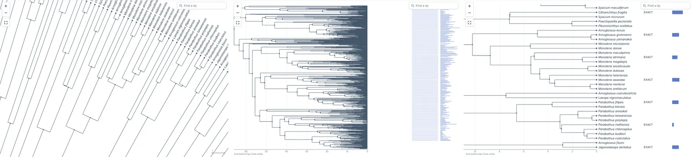

# Keeping the place when switching layouts (#56)

Written 2026-10-28. A zoomed view used to be refitted (or, from #61, moved to the selected node) whenever `layout` or `branchLengths`
changed. Now `switchView: 'keep'` (the default) keeps what was in view. The code is `viewContent` and `placeContent` in
[`packages/viewer/src/view-keep.ts`](../../packages/viewer/src/view-keep.ts), called from `setOptions` in `viewer.ts`. The rules are in the
API reference, "Switching layouts". This note compares the approaches the issue listed and says why the default is what it is.

Marks: **(M)** measured, with the command given. **(R)** from reading or reasoning about the code. **unverified**: not measured.

## What "the same view" means

The two layouts do not map windows onto each other. A rectangular window is a band of rows and a range of depths, with x and y zoomed
separately. A radial window is a box over a wedge, with one scale. So "the same view" has to mean about the same content at about the
same readability. The owner's answer on the issue (2026-10-23) fixed the meaning: keep the set of nodes in view and the zoom level, and
drop the rule that the selection wins (one often selects a node, moves elsewhere, and a switch must not jump back to it). Where the two
ends of the fan meet, choose the more likely end.

- **Readability** is the tip pitch: px between neighbouring tips, the measure the zoom cap of #38 and the label threshold use. Radial:
  the arc between tips at their median radius. **(R)**
- **The set** is a set of rows, so a collapsed clade counts as one. Both layouts of one tree have the same rows, so no tip map is needed,
  unlike `setTree`'s `keptViewport` (#27). **(R)**

## The approaches

1. **fit**: the whole tree (what `main` did with nothing selected).
2. **anchor**: the same pitch, centred on one tip, the one at the centre of the old window. Approaches 2 and 3 of the issue come to this
   once the pitch is the zoom.
3. **keep** (the default): the tips in view at the same pitch. The window frames them where they fit, and is moved as little as needed
   to hold them. Details:
   - To radial, it is centred on the sector of the old rows between the depths the old window showed, plus room for the labels, which
     run outward.
   - To rectangular, it goes as near the row the old window was centred on as holds them.
   - Where the ends of the fan meet, the end holding more of the tips is kept.
   - A view that the new fit shows at least as large is fitted.
4. **selection wins**: dropped, as the owner asked.

## Measured

`node --experimental-transform-types --conditions=@canopy/source scripts/measure-view-switch.mjs` in `packages/viewer`. **(M)** It uses the
fake DOM of the unit tests at 1000 x 700 px, with the default options (`maxTipSpacing: 'auto'`). For each tree it takes 15 clades of 6
to 40 tips, frames each with `zoomToNode` and switches the layout once:

- "Tips kept" is the share of the tips in view before the switch that are in view after it.
- "Whole clade" is the share of the clades whose every tip stays in view.
- "Pitch" is the tip pitch after the switch divided by the one before.

| Tree                                | Switch                | Approach | Tips kept (median, worst) | Whole clade | Pitch (median, range) | Tips in view (median) |
| ----------------------------------- | --------------------- | -------- | ------------------------- | ----------- | --------------------- | --------------------- |
| Carangaria MCC, 135 tips (dated)    | rectangular -> radial | fit      | 100%, 100%                | 100%        | 0.60, 0.60-0.88       | 27 -> 135             |
|                                     |                       | anchor   | 100%, 100%                | 100%        | 1.00, 1.00-1.00       | 27 -> 39              |
|                                     |                       | keep     | 100%, 100%                | 100%        | 1.00, 1.00-1.00       | 27 -> 39              |
|                                     | radial -> rectangular | fit      | 100%, 100%                | 100%        | 0.12, 0.05-0.21       | 19 -> 135             |
|                                     |                       | anchor   | 82%, 54%                  | 73%         | 0.58, 0.24-1.00       | 19 -> 27              |
|                                     |                       | keep     | 85%, 52%                  | 73%         | 0.58, 0.24-1.00       | 19 -> 27              |
| Fishes, Rabosky, 1,057 tips (dated) | rectangular -> radial | fit      | 100%, 100%                | 100%        | 0.08, 0.08-0.11       | 27 -> 1,057           |
|                                     |                       | anchor   | 100%, 100%                | 100%        | 1.00, 1.00-1.00       | 27 -> 39              |
|                                     |                       | keep     | 100%, 100%                | 100%        | 1.00, 1.00-1.00       | 27 -> 40              |
|                                     | radial -> rectangular | fit      | 100%, 100%                | 100%        | 0.05, 0.01-0.16       | 57 -> 1,057           |
|                                     |                       | anchor   | 80%, 60%                  | 100%        | 1.00, 0.34-1.00       | 57 -> 51              |
|                                     |                       | keep     | 86%, 64%                  | 100%        | 1.00, 0.34-1.00       | 57 -> 51              |
| Open Tree, Amphibia, 10k tips       | rectangular -> radial | fit      | 100%, 100%                | 100%        | 0.01, 0.01-0.01       | 29 -> 10,018          |
|                                     |                       | anchor   | 100%, 100%                | 100%        | 1.00, 1.00-1.00       | 29 -> 37              |
|                                     |                       | keep     | 100%, 100%                | 100%        | 1.00, 0.99-1.00       | 29 -> 37              |
|                                     | radial -> rectangular | fit      | 100%, 100%                | 100%        | 0.02, 0.01-0.03       | 224 -> 10,018         |
|                                     |                       | anchor   | 88%, 68%                  | 100%        | 1.00, 1.00-1.00       | 224 -> 225            |
|                                     |                       | keep     | 91%, 68%                  | 100%        | 1.00, 1.00-1.00       | 224 -> 226            |

Branch lengths (phylogram <-> cladogram) with `keep`, the same 15 clades, both directions, from the same script **(M)**:

| Tree                                | Layout      | Tips kept (median, worst) | Whole clade | Pitch (median, range) |
| ----------------------------------- | ----------- | ------------------------- | ----------- | --------------------- |
| Carangaria MCC, 135 tips (dated)    | rectangular | 100%, 100%                | 100%        | 1.00, 0.96-1.04       |
|                                     | radial      | 100%, 88%                 | 100%        | 1.00, 0.97-1.00       |
| Fishes, Rabosky, 1,057 tips (dated) | rectangular | 100%, 100%                | 100%        | 1.00, 0.96-1.04       |
|                                     | radial      | 100%, 86%                 | 100%        | 1.00, 1.00-1.00       |

What the numbers say:

- **fit keeps every tip and loses the readability.** After the switch the pitch is 1-12% of what it was on the larger trees, so the labels
  are gone. That is what the issue was about.
- **anchor and keep score about the same on these clades.** From rectangular, all the tips stay at the same pitch with both. From radial,
  80-91% stay (median). A wide radial window holds more tips along its arc than a band as high as the pane, and keep does not zoom out
  for them, so the middle ones are kept. Keep differs where the tips do not fit and where the window does not sit on them:
  - tips at different depths (a phylogram in the radial layout): it may zoom out to 3/4 of the pitch, never below the label threshold;
  - the ends of the fan;
  - label room (from rectangular, the labels are kept in view as well);
  - a view no deeper than the fit, which is fitted.
- **The 0.24-0.58 pitch from radial on the 135-tip tree is the rectangular zoom cap**, not the method. `zoomToNode` in the radial layout
  zooms a small tree to 50-90 px between tips, and `maxTipSpacing: 'auto'` (1.85 em, about 24 px) caps the rectangular rows. With
  `maxTipSpacing: Infinity` the browser check of the playground measures the same pitch both ways (87.3 -> 87.3 px). **(M)**
- **The rectangular branch-length switch keeps the y window exactly.** The 0.96-1.04 is the plot's height changing as the time axis comes
  and goes. Radial keeps 86-100% of the tips. **(M)**

Pictures, from the playground on the Rabosky tree, with the rectangular layout zoomed into a flatfish clade (*Monolene*, *Parabothus*).
Each shows the start, then `switchView: 'fit'` (as on `main`), then `'keep'`. Taken with Playwright in headless Chromium at 1400 x 900;
the full-size ones are not committed. **(M)**

## Choices and what they cost

- **The tips in a radial window are those in the inscribed ellipse.** The tips in the corners are left out. Taking every tip of the box
  and zooming out to hold them all made each switch to the rectangular layout and back zoom out further. In the unit test this ran from
  55.8 to 32.7 px between tips in a round and a half. **(M)** The other way, rectangular to radial, it may zoom out for tips at different depths
  (the 3/4 limit), but radial to rectangular never lowers the pitch.
- **Switched back untouched, the view goes back to the window it came from.** The viewer remembers the last switch. If the window is the
  one the switch made, and the layout and branch lengths are those it came from, the old window is restored exactly. Moved in between,
  each switch starts from what is in view. A view at an end of the tree may then walk a little over several switches: the unit test
  allows the clade to lose up to 40% of its tips after three moved round trips. **(M)**
- **Where the ends meet.** Rectangular to radial cannot meet the seam: a band of rows is one arc. Radial to rectangular takes the end
  with more of the tips (ties: the end before the seam). The other end is only a neighbour on the circle. **(R)**
- **A window with no tip in view** (only branches, near the root) is fitted, as before. A view near the root of a big tree would need
  another rule, for example the depth range. Not done. **(R)**
- **Cost.** The mapping runs once per switch. It reads the row interval of the window (rectangular) or the rows of the angles the window
  covers (radial), tested one by one, at most 65,536 of them (a stride beyond). It does not walk the tree, except up one path from a tip
  to the root for the rectangular branch-length switch. On OTL 100k (90,938 tips): 0.01 ms zoomed in, 3.5-3.8 ms for half the tree or with the root in the window, median of 7 runs, Node 22 in the cloud sandbox (the last part of the same script). **(M)** The 2.39M-tip tree is bounded by the same
  65,536 rows, so it should cost about the same. **unverified**: it was not run.
- **Not in scope:** the unrooted layout and the table (no such layouts yet), animation of the switch, a partial source (fitted), and
  `setCollapsed` (which keeps its own window, `remapRow`).
