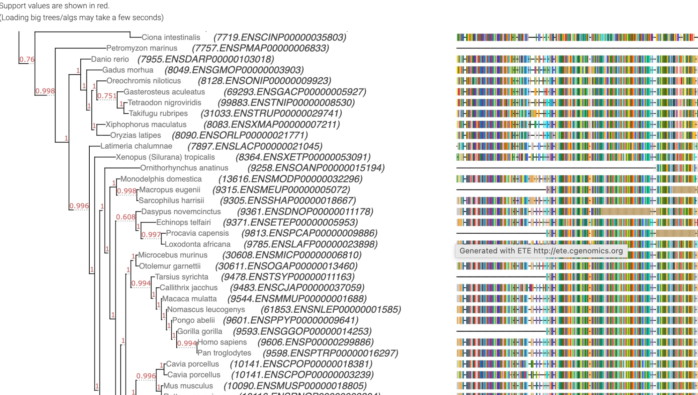
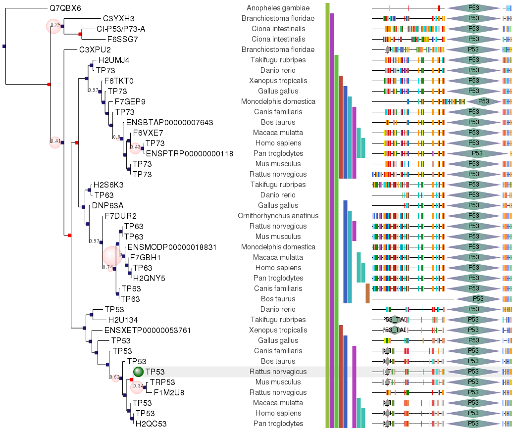

# Goal

## Problem

GBIF datasets are mostly tables (checklists, occurrences). Some publishers also have a phylogeny of the organisms in the dataset, but gbif.org has no way to show it. We want publishers to attach a tree as a supplementary file and users to explore it on the dataset page, and to see where an occurrence sits in that tree.

## User stories

1. As a **publisher**, I attach a tree (Newick/Nexus/...) to my dataset and it shows up without extra work.
2. As a **user on a dataset page**, I open a *Phylogeny* tab and can pan, zoom, collapse/expand clades, search for a tip, and see branch lengths and support values.
3. As a **user**, I can click a tip and jump to the matching occurrence(s) or taxon page; unmatched tips are visible, not silently dropped.
4. As a **user on an occurrence page**, I see the tree with that occurrence's tip highlighted, centred, with enough context (siblings, parent clade) to be meaningful.
5. As a **developer**, I embed the viewer as a component with a small API: load tree, highlight tips, listen to click/hover events, supply per-tip metadata.

## Evaluation criteria

| # | Criterion | Why it matters |
|---|-----------|----------------|
| 1 | Pure browser runtime, static-file deployable | Trees come from a remote archive; no per-user backend |
| 2 | Embeddable component (npm, framework-agnostic or React) | Must live inside the gbif.org app |
| 3 | Scale: 100k+ tips responsive | Some published trees are large |
| 4 | Formats: Newick, Nexus, phyloXML (NeXML nice-to-have) | Publishers use all of these |
| 5 | Programmatic API: highlight, focus, metadata | Occurrence linking |
| 6 | Layouts: rectangular, circular, (unrooted) | Standard expectations |
| 7 | Licence compatible with gbif.org (ETE/GPL already ruled out) | GPL/AGPL need deliberate sign-off |
| 8 | Maintenance health | We will depend on it for years |
| 9 | Accessibility / theming / mobile | Fits GBIF design system |
| 10 | Export (SVG/PNG/Newick) | Nice-to-have |
| 11 | **Interaction callbacks:** click/hover/select on nodes and tips run our own function, with the node and its metadata as argument | Click a tip to open an occurrence or taxon; sync with the rest of the page |
| 12 | **React integration:** a React component, or a thin wrapper, whose events reach callbacks and hooks and whose state (selection, highlighted tips, viewport) can be controlled from React props/state; clean mount/unmount | gbif.org is a React app; the tree must not live in a separate world |
| 13 | **Custom node/tip rendering:** per-tip content aligned beside the tree (text, badges, thumbnails, heat maps, sequence alignments as in ETE's alignment view), driven by our metadata, ideally with React-rendered content | Occurrence counts, match status, images; some datasets will ship alignments |

## Reference: the kind of customisation we want

Two screenshots of ETE-rendered trees, supplied as examples of what "custom nodes" can look like. ETE itself is ruled out (GPL), so these are a target for behaviour, not a dependency.

What they show, and what we would need from a library:

| Seen in the screenshots | Requirement |
|-------------------------|-------------|
| Decorations on **internal nodes**: coloured squares, and circles sized by support value | Per-node markers on internal nodes, not just tips; size/colour driven by data |
| Several **tip labels** per row (gene name, then species) | Multiple text fields per tip, styled separately |
| Aligned **columns** to the right: presence/absence bars, coloured sequence alignment, domain architecture with shapes (e.g. "P53") | Arbitrary aligned per-tip graphics, in several columns, lined up across all rows |
| One row **highlighted** (grey band plus a green sphere on the tip) | Row highlight and a focus marker, set from outside (this is the occurrence-page case) |
| Support values as small labels on branches | Branch labels |
| A hover tooltip on the alignment column | Tooltips on custom graphics |

Content like the alignment and domain columns is probably not needed at launch. Occurrence counts, match status and a highlighted tip are. But the library choice should not rule the richer cases out.

## Non-goals (for now)

- Tree inference, alignment, or editing.
- Hosting an ETE-style Python backend as part of GBIF infrastructure (unless the research says it is the only option).

## Open questions

- Maximum tree sizes seen/expected in GBIF datasets?
- Where is the supplementary file stored (the DwC-A / EML-referenced file, or a separate archive endpoint) and is it CORS-accessible?
- How are tip labels linked to occurrences: `occurrenceID`, `scientificName`, a dedicated mapping column?
- Do we pre-process trees server-side (e.g. into an indexed/chunked format) or parse client-side?
